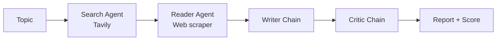

# RESEARCH MIND
# Live Demo Link :https://multi-agent-research-assistant-0kb5.onrender.com

A multi-agent AI research assistant. Give it a topic and four stages work in sequence to produce a structured, sourced research report, which is then reviewed and scored by a critic.

> **Search → Read → Write → Critique**

## How it works



| Stage | Type | What it does |
|-------|------|--------------|
| **Search** | Agent (tool calling) | Finds recent sources on the web with Tavily and returns titles, URLs and snippets |
| **Reader** | Agent (tool calling) | Picks the most relevant URL and scrapes its text for deeper content |
| **Writer** | Prompt chain | Combines search results and scraped content into a structured report |
| **Critic** | Prompt chain | Reviews the report and returns a score out of 10 with strengths and improvements |

## Features

- Live pipeline progress in the Streamlit UI
- Report download as **Markdown, Text, Word (.docx) or HTML** (open the HTML and print to PDF)
- Optional critic feedback included in the downloaded file
- Error handling: if scraping fails, the report is still written from search results
- Works from the terminal too (`python pipeline.py`)
- Model is configurable through an environment variable

## Tech stack

- **Python**
- **LangChain** (agents and chains)
- **Groq** LLMs (default: `openai/gpt-oss-120b`), OpenAI or Gemini can be swapped in
- **Tavily** (web search API)
- **BeautifulSoup + requests** (scraping)
- **Streamlit** (UI)

## Project structure

```
quartet-research/
├── agents.py          # LLM setup, search/reader agents, writer/critic chains
├── tools.py           # web_search and scrape_url tools
├── pipeline.py        # runs the 4 stages in order (also a CLI)
├── app.py             # Streamlit web UI
├── requirements.txt
├── .env.example
└── README.md
```

## Setup

**1. Clone the repo**

```bash
git clone https://github.com/rajatcse9-a11y/multi-agent-research-assistant.git
cd RESEARCHMIND
```

**2. Create a virtual environment**

```bash
python -m venv venv
venv\Scripts\activate          # Windows
# source venv/bin/activate     # Mac / Linux
```

**3. Install dependencies**

```bash
pip install -r requirements.txt
```

**4. Add your API keys**

Create a `.env` file in the project folder (see `.env.example`):

```
TAVILY_API_KEY=your_tavily_key
GROQ_API_KEY=your_groq_key
# Optional: change the model without touching the code
GROQ_MODEL=openai/gpt-oss-120b
```

- Tavily key: https://app.tavily.com
- Groq key: https://console.groq.com

## Run

**Web UI**

```bash
streamlit run app.py
```

Open http://localhost:8501, enter a topic and click **Run research**.

**Terminal**

```bash
python pipeline.py
```

The report is saved as `research_report_<timestamp>.md`.

## Configuration notes

- **Model names change.** Groq retires models from time to time. If you get a `model_not_found` error, check the current model list at https://console.groq.com/docs/models and update `GROQ_MODEL`.
- **Rate limits.** On free tiers you may hit request or token limits. Retrying after a short wait, or using a smaller model, usually helps. Scraped text is truncated to keep requests small.
- **Using OpenAI or Gemini.** Replace the LLM line in `agents.py` with `ChatOpenAI` or `ChatGoogleGenerativeAI` and install the matching package.

## Limitations

- The Reader scrapes only one page per run, so depth depends on that source.
- Some websites block scrapers or load content with JavaScript, which the scraper cannot read.
- Reports are generated by an LLM and should be fact-checked before being used for anything important.

## Future improvements

- Scrape and summarize multiple sources in parallel
- Add RAG with a vector store to handle longer source content
- Rank sources by relevance before reading
- Evaluate reports across models and log critic scores
- Export directly to PDF

## License

MIT. See `LICENSE` for details.
